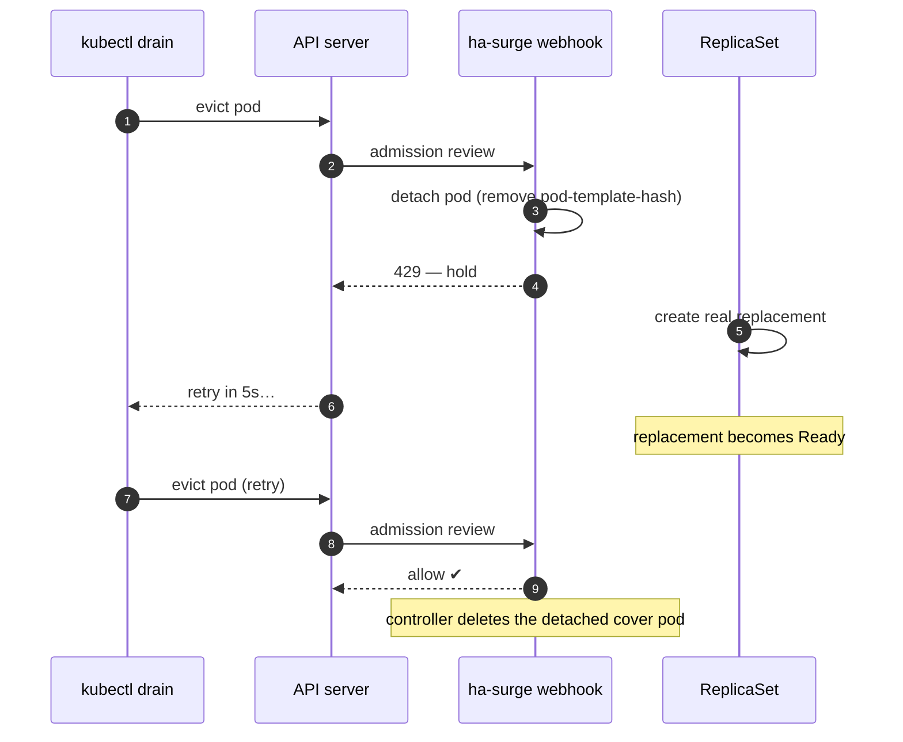

# ha-surge

[](https://github.com/lhns/kube-ha-surge/actions/workflows/ci.yaml)
[](https://github.com/lhns/kube-ha-surge/releases)
[](LICENSE)

> **Make-before-break high availability for single-replica Deployments during node drains** — new pod Ready first, old pod gone second, *without* permanently running two replicas.

ha-surge is a small Kubernetes operator. Opt a workload in, and when its node is
drained ha-surge holds the pod's eviction, brings up a real replacement **first**,
and only then lets the old pod go. No coverage gap, no idle second replica, and
`spec.replicas` is never touched — so GitOps controllers have nothing to fight.

> The repository and Go module are `github.com/lhns/kube-ha-surge`; the operator,
> image, and Helm chart are named **`ha-surge`**.

## Contents

- [Why](#why) · [How it works](#how-it-works) · [Install](#install)
- [Enrol workloads](#enrol-workloads) · [Configuration](#configuration)
- [Safety & limitations](#safety--limitations) · [Documentation](#documentation) · [License](#license)

## Why

A single-replica Deployment is down for tens of seconds every time its node is
drained (node upgrades, autoscaler consolidation, `kubectl drain`): the pod is
evicted, and only *then* does the ReplicaSet start its replacement — which still
has to schedule, pull, start, and pass readiness. The usual fixes don't fit:

| Approach | Why it falls short |
| --- | --- |
| **Permanently run two replicas** | Works, but doubles the standing footprint of *every* such service 24/7 — just to cover a drain that lasts seconds, a handful of times a month. Across many single-replica workloads that adds up fast. |
| **`minAvailable: 1` PDB** | Blocks the drain *forever* — a PDB can refuse disruption, but it can't create capacity. |
| **Fixed pre-stop sleep** | Guesswork: too short still drops traffic, too long slows every drain, and it never brings replacement capacity up *first*. |

ha-surge covers the drain window on demand — **new pod Ready first, old pod gone
second** — then it's back to a single replica. You pay for the second pod only
during the seconds it's actually needed.

## How it works



When an opted-in single-replica Deployment's pod is evicted, the admission
webhook:

1. **Detaches** the doomed pod from its ReplicaSet by removing its
   `pod-template-hash` label. The RS stops counting it and immediately creates a
   *real* replacement; the pod keeps its app labels, so the Service keeps routing
   to it and it keeps serving. No clone, no scaling.
2. **Holds the eviction** with an HTTP 429, which `kubectl drain` retries
   automatically — the drain politely waits instead of failing.
3. **Allows** the eviction once the replacement is **Ready**. A controller then
   deletes the detached cover pod.

**Fail-open by design** (`failurePolicy: Ignore`): if the operator is down or
erroring, evictions pass straight through. A broken ha-surge can *slow* a drain,
never wedge it. The operator itself runs HA (2 replicas + PDB) because it sits on
the eviction path.

## Install

Helm (OCI chart on GHCR):

```sh
helm install ha-surge oci://ghcr.io/lhns/charts/ha-surge \
  -n ha-surge-system --create-namespace
```

This defaults to cert-manager for the webhook's serving certificate. No
cert-manager in the cluster? Use the self-signed path — zero external deps:

```sh
helm install ha-surge oci://ghcr.io/lhns/charts/ha-surge \
  -n ha-surge-system --create-namespace \
  --set webhook.certSource=helm
```

Images and charts are published to GHCR for every release
(`ghcr.io/lhns/ha-surge`, `oci://ghcr.io/lhns/charts/ha-surge`), cosign-signed
with SBOMs attached.

## Enrol workloads

Enablement rides on one key, `ha-surge.lhns.de/enabled`, resolved most-specific-wins:

```
Deployment annotation   →   Namespace label   →   chart defaultEnabled (default: false)
```

The common case is **one label on a namespace** — every single-replica Deployment
in it is then covered, new ones included:

| Goal | Command |
| --- | --- |
| Protect a namespace | `kubectl label ns my-app ha-surge.lhns.de/enabled=true` |
| Exempt one Deployment | `kubectl annotate deploy noisy -n my-app ha-surge.lhns.de/enabled=false` |
| Protect the whole cluster | install with `--set defaultEnabled=true` |

> With the default `defaultEnabled=false`, a Deployment annotation only takes
> effect if its namespace is at least labelled `enabled=true` — the apiserver gates
> the webhook on namespace labels first ([details](docs/limitations.md)).

Then drain the node and watch the old pod cover while the replacement comes up:

```sh
kubectl drain <node> --ignore-daemonsets --delete-emptydir-data
kubectl get pods -n my-app -l ha-surge.lhns.de/detached=true
```

## Configuration

### Helm values

The values you'll actually touch — full list in [`docs/reference.md`](docs/reference.md):

| Value | Default | What it does |
| --- | --- | --- |
| `defaultEnabled` | `false` | Cluster-wide opt-in floor; also scopes the webhook. `true` covers every namespace except opt-outs. |
| `excludeNamespaces` | `[]` | Extra namespaces never touched when `defaultEnabled: true` (`kube-system` + the release namespace are always excluded). |
| `maxSurgeSeconds` | `120` | Max time to hold an eviction waiting for the replacement before failing open. |
| `webhook.certSource` | `cert-manager` | `cert-manager` (cainjector) or `helm` (self-signed, zero deps). |
| `webhook.failurePolicy` | `Ignore` | **Keep `Ignore`** — fail-open is mandatory. |
| `replicaCount` | `2` | Operator replicas. Both serve admission; the leader runs the GC controller. |
| `podDisruptionBudget.enabled` | `true` | PDB so a node drain can't take both operator replicas at once. |
| `leaderElection.enabled` | `true` | Leader election for the (singleton) GC controller. |
| `image.repository` / `image.tag` | `ghcr.io/lhns/ha-surge` / chart `appVersion` | Operator image. |
| `resources` | `50m`/`64Mi` → `500m`/`256Mi` | Operator container requests/limits. |

### Labels & annotations

| Key | Set on | Meaning |
| --- | --- | --- |
| `ha-surge.lhns.de/enabled` | Namespace label **or** Deployment annotation | Opt in / out (`"true"` / `"false"`). |
| `ha-surge.lhns.de/detached` | set *by* ha-surge on the cover pod | Marks a pod detached to cover a drain. |

Manager flags, RBAC, and the fixed resource names are in [`docs/reference.md`](docs/reference.md).

## Safety & limitations

ha-surge only ever *skips* — never forces. It passes an eviction straight through
when it can't help safely:

- **`ReadWriteOnce` / single-writer volumes** — a replacement can't co-mount the volume (Multi-Attach).
- **`strategy: Recreate`** — the workload declared "never two at once".
- **Already `replicas >= 2`** — normal replication already covers disruption.
- **Non-Deployment owners** (StatefulSet, bare pod, Job) — out of scope in v1.
- **A Service that selects on `pod-template-hash`** — detaching would break routing.

It shortens the *planned*-drain gap; it is **not** a substitute for real
replication against an unplanned hard node crash. And don't pair a covered
workload with a blocking `minAvailable` PDB — the PDB pre-empts the webhook.
Full detail: [`docs/limitations.md`](docs/limitations.md).

## Documentation

- **[Getting started](docs/getting-started.md)** — install → enrol → watch a drain, end to end
- **[Reference](docs/reference.md)** — every label, annotation, flag, and Helm value
- **[Limitations](docs/limitations.md)** — what it deliberately won't do
- **[Architecture decisions](docs/adr/README.md)** — the ADRs behind how it works
- [Changelog](CHANGELOG.md) · [Security policy](SECURITY.md)

## License

[Apache License 2.0](LICENSE) — © 2026 Pierre Kisters and contributors. See [NOTICE](NOTICE).
